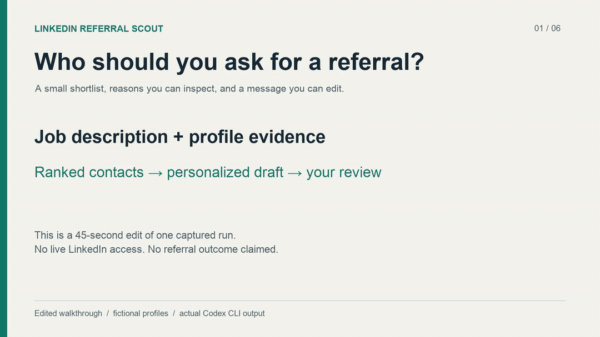

# LinkedIn Referral Scout

**Turn a job description into a ranked referral shortlist and personalized drafts you review before contacting anyone.**

A reusable agent skill for job seekers who want to know whom to approach, why that person fits, and how to start a useful conversation. It works from professional profile excerpts you supply, or through a supported connection to your signed-in Chrome session.

```text
Job description + your experience + profile evidence
                         ↓
           3–5 contacts, ranked with reasons
                         ↓
         Personal message options for each person
                         ↓
             Your review before any contact
```

**Try it without LinkedIn access:** use the [fictional demo input](examples/demo-input.md) and compare the result with the [sample walkthrough](examples/walkthrough.md).

[](assets/referral-scout-demo.mp4)

[Watch or download the 45-second video](assets/referral-scout-demo.mp4) · [Read the full captured output](examples/recorded-run.md)

The video presents unchanged excerpts from a real run, edited into a visual walkthrough. It uses fictional profiles and is not a screen recording, a live LinkedIn demonstration, or a referral-success claim.

## What you get

| Output | What it answers |
|---|---|
| Ranked shortlist | Who has the strongest overlap with this role? |
| Evidence for each choice | Which professional facts support the recommendation, and what is uncertain? |
| Optional alumni preference | Is there a supported connection to your chosen institution or program? |
| Personalized drafts | Would advice-first, alumni, experience-led, or direct outreach fit this relationship? |
| Approval preview | Exactly who would receive what, through which action, with which links? |

Role relevance comes first. An engineer working on the relevant system can outrank an alumnus in an unrelated department. The skill distinguishes confirmed evidence from assumptions and does not invent a shared university, relationship, achievement, or hiring role.

## Try the fictional example

You need an agent that can read local Markdown instructions, such as Codex. The supplied-evidence demo requires no LinkedIn login, browser integration, or API key in this repository. Your agent's own access requirements and usage costs still apply.

Clone and open this folder in your agent:

```sh
git clone https://github.com/amulyagupta1278/linkedin-referral-scout.git
cd linkedin-referral-scout
```

Ask:

```text
Read SKILL.md and apply it to examples/demo-input.md.
Use only the fictional evidence in that file. Do not browse or contact anyone.
Rank the contacts, explain the evidence and uncertainties, and draft two
message options for the best first contact. Stop at the approval preview.
```

This demonstrates the workflow on synthetic evidence. It does not demonstrate live LinkedIn access or predict whether a real person will offer a referral.

## Install as a Codex skill

### Install in your project with the skills CLI

Requires Git, Node.js 22.20 or later, and your own Codex access. Run this from the project folder where you want to use the skill:

```sh
npx skills add amulyagupta1278/linkedin-referral-scout --agent codex
```

Open that project in Codex, then try:

```text
Use $linkedin-referral-scout and apply it to
.agents/skills/linkedin-referral-scout/examples/demo-input.md.
Use only the fictional evidence. Do not browse or contact anyone.
Rank the four contacts, explain uncertainty, and draft two messages
for the best first contact. Stop at the manual-handoff preview.
```

Verified on macOS with skills CLI 1.7.2, Node 24.19.0, and Codex CLI 0.162.0-alpha.17.2. The installed example files and a full supplied-evidence run were checked. Windows and other agent hosts have not been verified.

The skills CLI collects installation telemetry by default; its [documentation](https://www.skills.sh/docs/cli) describes the `DISABLE_TELEMETRY=1` opt-out. Maintainer smoke tests used that opt-out and are not counted as outside-user adoption. This installation route does not establish a skills.sh ranking or GitHub Trending placement.

### Install manually for all your projects

For a user-level installation on macOS or Linux using Git:

```sh
mkdir -p "$HOME/.agents/skills"
git clone https://github.com/amulyagupta1278/linkedin-referral-scout.git \
  "$HOME/.agents/skills/linkedin-referral-scout"
```

If that folder already exists, inspect your existing installation instead of overwriting it. Avoid installing another copy under the same skill name in a different discovery directory. Codex detects installed skills; restart it if the skill does not appear. These locations and invocation behavior are documented in [OpenAI's skill guide](https://developers.openai.com/codex/skills).

Then ask:

```text
Use $linkedin-referral-scout for this job description.

Job: [paste the description or URL]
My relevant experience: [one or two truthful achievements]
Preferred alumni institution/program: [optional; say none to skip]
My own connection to that institution: [state it truthfully, or none]
Profile evidence: [paste relevant excerpts and source URLs]

Rank up to five people and prepare personalized drafts. Do not contact anyone.
```

The package uses the Agent Skills format. Other hosts may load it according to their own instructions; cross-host behavior has not been verified.

## Using live LinkedIn research

Live research additionally needs a host-provided browser tool that can access the Chrome session you authorize. This repository does not install a browser tool, supply a LinkedIn connector, or manage login credentials. A CLI-only or remote environment may not have this capability.

1. Confirm your agent has a supported Chrome connection.
2. Sign into LinkedIn yourself.
3. Ask the agent to research the role through that connection, with any alumni preference stated explicitly.
4. Review the shortlist and drafts. Contacting someone requires a separate, exact action preview and approval.

If no supported browser connection is available, copy the relevant professional profile excerpts into the supplied-evidence workflow. A profile URL alone is not evidence of employment, education, or a relationship.

## Boundaries and limitations

- This is an instruction-based skill. It has no executable service, mass-outreach engine, or autonomous follow-up scheduler.
- The approval checkpoint is a behavioral instruction, not a technical access-control mechanism. Review the agent's actions and your host's permissions.
- Research is limited to a small shortlist. The instructions exclude scraping services, access-control bypasses, cookie inspection, and contact actions during research.
- Your agent provider and browser integration may process the information you supply. This repository has no telemetry service of its own; that does not mean the surrounding tools process everything locally.
- Profiles can be incomplete or outdated. Confirm critical details before contacting someone, and use LinkedIn and your tools within their applicable rules.
- No claims of referrals obtained, time saved, or live-browser reliability are made for this release. The included example is fictional.

Independent project; not affiliated with or endorsed by LinkedIn or OpenAI.

## Contribute

Useful contributions include anonymized failure cases, clearer setup instructions, and evidence of behavior on another host. See [CONTRIBUTING.md](CONTRIBUTING.md) and the [behavioral review cases](evals/scenarios.md). Never submit real resumes, private contact lists, message histories, or credentials in issues or pull requests.

Trying the fictional example for the first time? [Report your first-run feedback](https://github.com/amulyagupta1278/linkedin-referral-scout/issues/new?template=first-run.yml): whether setup worked, the first confusing step, and whether the ranking and drafts were useful. There is no need to share a resume or connect LinkedIn.

If the workflow is useful, a star helps people discover it. More useful still: describe where the sample or setup was confusing.

## License

[MIT](LICENSE) © 2026 Amulya Gupta.
